<div align="center">



<a href="https://git.io/typing-svg"></a>


</div>

---

### 🕷️ `whoami`

```bash
cyberpsidey@nightcity:~$ whoami
> 3rd-year B.Tech Cybersecurity student
> part analyst, part builder, full-time web-weaver

cyberpsidey@nightcity:~$ cat mission.txt
> Build tools that help real people when something goes wrong online.

cyberpsidey@nightcity:~$ cat sidekick.txt
> Psidey v2.0: eight legs, one visor, zero unpatched CVEs.
> Hangs out in the banner up top. Says hi. 👋
```

### 🕸️ Threads I'm spinning

<table>
<tr>
<td width="50%" valign="top">

#### 🔍 [CyberTrace](https://github.com/cyberpsidey/CyberTrace)

A privacy-first web app and browser extension that helps fraud victims, students, and incident-response teams **collect, preserve, and report digital evidence** after a cyber incident. Hashing, OCR, metadata extraction, indicator tracking, timelines, and one-click reports.


</td>
<td width="50%" valign="top">

#### 🧭 [Attack Path Visualizer](https://github.com/cyberpsidey/attack-path-visualizer)

An interactive GUI that maps a network as a graph and walks it with **BFS and DFS** to reveal how an attacker could move from an entry point to a critical asset. Built to make algorithms feel like real security work.


</td>
</tr>
</table>

### 🧰 Web-shooter toolkit

<p align="center">
  
</p>

### 📡 Network activity

<div align="center">


</div>

### 🐍 Psidey vs. the contribution grid

<picture>
  <source media="(prefers-color-scheme: dark)" srcset="https://raw.githubusercontent.com/cyberpsidey/cyberpsidey/output/snake-dark.svg"/>
  
</picture>

### ⚡ Side quests

- 🎯 **Currently learning:** digital forensics, threat intel, and secure API design
- 🧪 **Practicing on:** CTFs and hands-on labs
- 💬 **Ask me about:** incident evidence, graph algorithms in security, FastAPI
- 🤝 **Open to:** internships, collabs, and CTF teammates
- 🍜 **Fuel:** chai and a good bug hunt

### 📬 Send a signal

<!-- Replace the # links with your real profiles -->
<p>
  <a href="#"></a>
  <a href="#"></a>
  <a href="#"></a>
</p>

<details>
<summary>🕷️ <b>Don't open this.</b></summary>

<br/>

```text
[psidey.log] intrusion attempt detected on port 1337
[psidey.log] origin: you, clicking things you were told not to
[psidey.log] verdict: curious. classification: future teammate.
[psidey.log] action: connection allowed. hi there. 🕸️

        /\  .-"""-.  /\
       //\\/  ,,,  \//\\
       |/\| ,;;;;;, |/\|
       //\\\;-"""-;///\\
      //  \/   .   \/  \\
     (| ,-_| \ | / |_-, |)
       //`__\.-.-./__`\\
      // /.-(() ())-.\ \\
     (\ |)   '---'   (| /)
      ` (|           |) `
        \)           (/
```

</details>

<div align="center">

</div>
